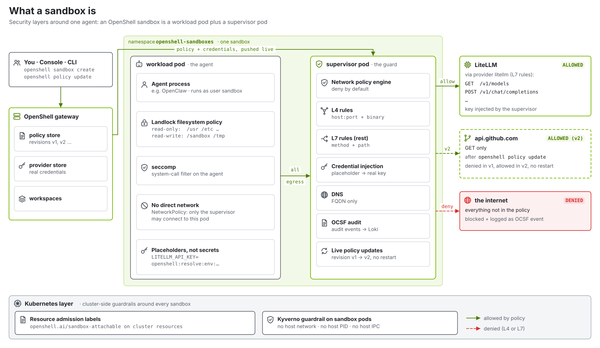
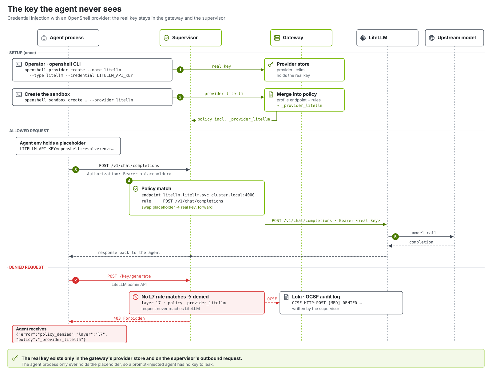
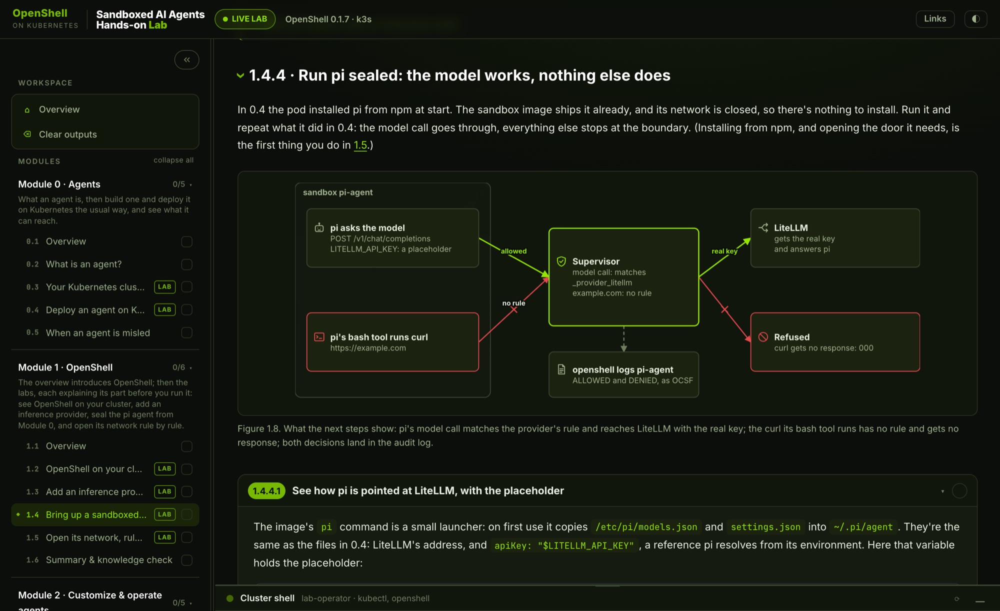

# OpenShell on Kubernetes — a Brev Launchable

Stand up **[NVIDIA OpenShell](https://docs.nvidia.com/openshell/) 0.1** on a real Kubernetes
cluster and run **agents** ([pi](https://github.com/earendil-works/pi)) inside isolated, policy-controlled sandboxes —
on a **single VM**, with **one command**.

It's a teaching launchable. You get the platform (k3s, the OpenShell gateway, Keycloak sign-in,
the [OpenShell Console](https://github.com/ai-openshell/console), LiteLLM, Prometheus, Grafana,
Loki and Tempo) and, separately, a **training site** with lessons and a live in-browser terminal
that walks you through it: sandboxes, deny-by-default network policy, credentials the agent never
sees, the audit trail, MCP tools and Agent Skills, and a multi-agent SRE capstone.


**A sandbox is two pods.** The workload pod runs the agent as an unprivileged user under
Landlock and seccomp and has no network of its own. The supervisor pod owns its network:
deny by default, allow per host, port and binary, and per HTTP method and path. It injects
provider credentials on allowed requests only and writes an OCSF audit event for every decision.



**The agent never holds the key.** Models come from the `litellm` **provider**: the sandbox sees
`LITELLM_API_KEY=openshell:resolve:env:…`, and the supervisor swaps in the real key only on the
calls the provider's profile allows (`POST /v1/chat/completions`, …). LiteLLM's admin API is
refused with `403 policy_denied`.



## Quick start (on the VM)

```bash
cp .env.example .env
$EDITOR .env            # MODEL_API_KEY (+ MODEL_BASE_URL / MODEL_NAME if not build.nvidia.com)
./scripts/setup.sh      # installs Ansible and brings up everything (~20-25 min on first boot)
```

`setup.sh` installs Ansible, writes a localhost inventory and a secrets file from `.env`, runs
the playbook, then builds and serves the training site. It is **idempotent**: re-run it after
editing `.env`, or run one layer with `ANSIBLE_TAGS=gateway ./scripts/setup.sh`.

### Reach it

With sign-in on (`ENABLE_SSO=true`, the default) create two Brev **Secure Links**. `setup.sh` reads
them from the instance (`/etc/brev/environment-context.json`), so the URLs are picked up automatically:

| Link name | Host port | What |
|---|---|---|
| `openshell` | `3001` | training site `/` · Keycloak `/auth` · Grafana `/grafana` |
| `console` | `3002` | the OpenShell Console |

Sign in as **`demo`** (platform admin) or **`learner`** (user); the passwords are generated into
`.sso-secrets.env` on the VM (`grep KC_ .sso-secrets.env`). Details: [brev/launchable.md](brev/launchable.md).

Or drive it from the VM; the `openshell` CLI is already set up as the lab operator:

```bash
export KUBECONFIG=/etc/rancher/k3s/k3s.yaml
openshell status
openshell sandbox list
openshell sandbox exec -n agent-0 -- pi --no-session -p "Write a haiku about Kubernetes pods"
```

## The course

The training site (`training/`) takes about four and a half hours, end to end. Every lab step has a **Run**
button that runs its command on your VM, next to the output recorded on a real run.



| Module | What you do |
|---|---|
| **0 · Agents** | What an agent is; deploy one on Kubernetes the usual way, and see what it can reach. |
| **1 · OpenShell** | The platform on your cluster; add an inference provider in your own workspace; bring up a sandboxed pi agent and open its network rule by rule. |
| **2 · Customize & operate** | Give an agent a persona; read every decision in the audit trail (OCSF, Loki, Grafana); use the OpenShell Console. |
| **3 · Tools and skills** | An MCP server on the cluster, with a policy that decides which tools an agent may call; Agent Skills shared through git. |
| **4 · Capstone** | An SRE copilot fleet of sealed specialists investigates a real outage, and you approve the fix. |
| **5 · Going further** | Tear down; high availability, more nodes, a namespace per team, other agents. |

## What it deploys

| Component | Namespace | Version | Notes |
|---|---|---|---|
| **k3s** | — | v1.37 channel | single-node Kubernetes |
| **agent-sandbox controller** | `agent-sandbox-system` | v1.0.10 | reconciles `Sandbox` CRs into workload pods |
| **OpenShell gateway** | `openshell` | 0.1.7 | StatefulSet + SQLite; OIDC (Keycloak) for people, mTLS `OU=operator` for the VM's CLI; NodePort 30808 |
| **Sandboxes** | `<workspace>` (`lab`, `dev`) | 0.1.7 | one namespace per workspace (operator mode): labelled `openshell.ai/workspace=true`, with the `openshell-workspace` chart; `lab` is the platform's; workload pod + supervisor pod each; default image `ghcr.io/ansjindal/openshell-on-k8s/pi-sandbox` (pi 1.5.2) |
| **OpenShell Console** | `openshell` | 0.1.3 | [ai-openshell/console](https://github.com/ai-openshell/console) behind oauth2-proxy |
| **LiteLLM** | `litellm` | 1.108.4 | OpenAI-compatible endpoint in front of your model; alias `default` |
| **Keycloak** | `keycloak` | 26.8.2 | realm `openshell`; users `demo` (admin) and `learner` (user) |
| **cert-manager** | `cert-manager` | v1.21.3 | gateway TLS, the operator certificate, the lab CA |
| **Envoy Gateway** | `envoy-gateway-system` | v1.10.0 | Gateway API ingress for the public hosts |
| **Monitoring** | `monitoring` | kps 92.21.1 · Loki 7.5.0 · Tempo 1.24.4 · Alloy 1.15.0 | metrics, logs, OCSF audit events, agent traces *(toggle)* |
| **Kyverno** | `kyverno` | 3.9.2 | guardrails on sandbox pods *(toggle)* |
| **Skill repository** | `skills` | Gitea 28.2 | `platform/skills`, Agent Skills every sandbox clones read-only |
| **sre-tools** | `tools` | MCP SDK 1.32 | the MCP server agents call for pods, events, Prometheus, Loki and Tempo |
| **Training site** | host (systemd) | — | `training/`: Next.js lessons + live terminal *(toggle)* |

## What changed in OpenShell 0.1 (and in this lab)

- **No managed inference route.** `inference.local` and `openshell inference` are gone. Models are
  a provider attached to each sandbox (`--provider litellm`); see the *Add an Inference Provider*
  lesson.
- **No gVisor.** The 0.1 sandbox runtime requires Landlock ABI v3 and seccomp notifications in
  the workload, which gVisor does not implement. Isolation now comes from the two-pod design,
  Landlock, seccomp and the supervisor's network policy.
- **Sign-in everywhere.** The gateway accepts no anonymous calls; the console and Grafana use
  Keycloak, the lab CLI an operator certificate.
- **Resource admission.** Cluster resources a sandbox wants to use (RuntimeClass, volumes) need the
  operator label `openshell.ai/sandbox-attachable=true`.
- **Audit and traces built in.** Supervisors log an OCSF event per decision (shipped to Loki) and
  relay agent spans to Tempo.

## Configuration

Everything is driven by `.env` (see [.env.example](.env.example)):

- `MODEL_API_KEY` / `MODEL_BASE_URL` / `MODEL_NAME`: the upstream model.
- `ENABLE_SSO`: Keycloak, Envoy ingress, Grafana SSO and the console. `ENABLE_MONITORING`, `ENABLE_KYVERNO`: toggles.
- `PUBLIC_BASE_URL`, `CONSOLE_URL`, `BREV_URL_DOMAIN`: only to override the URLs detected from the Brev links.
- `CREATE_FLEET`, `FLEET_SIZE`: the initial sandboxes, `agent-0` and up (one by default).
- `ENABLE_TRAINING`: the training site (set `false` for the platform only).

## Layout

```
scripts/setup.sh          # entrypoint: single-VM bring-up
scripts/fleet             # runtime ops for agent-0..N: up / down / status / task / shell / logs
scripts/fleet.sh          # Module 4 capstone: the SRE copilot fleet from a spec (fleet.txt)
scripts/lab-cli-setup.sh  # point a user's openshell CLI at the gateway as the lab operator
ansible/                  # the platform (roles 02-18; single node by default)
manifests/                # policies, the demo apps, the MCP server, the fleet's roles
skills/                   # the platform's Agent Skills (seed of the in-cluster skill repository)
images/pi-sandbox/        # the default sandbox image (pi on the OpenShell community base)
training/                 # the training site: lessons (src/content/*.mdx) + live terminal
docs/                     # architecture, diagrams (SVG)
brev/                     # Brev Launchable wizard mapping + setup wrapper
```

## Multi-node

The same Ansible drives a multi-node cluster from a workstation over SSH: fill in
`ansible/inventory/hosts.ini`, set `mesh_iface` if your nodes use a mesh NIC, and run the
playbook directly. See [ansible/README.md](ansible/README.md).

## License

Apache-2.0 — see [LICENSE](LICENSE). Built on
[NVIDIA OpenShell](https://github.com/NVIDIA/OpenShell),
[OpenShell Console](https://github.com/ai-openshell/console),
[kubernetes-sigs/agent-sandbox](https://github.com/kubernetes-sigs/agent-sandbox),
[LiteLLM](https://github.com/BerriAI/litellm), [k3s](https://k3s.io), Keycloak, Envoy Gateway,
cert-manager, Kyverno and the Grafana stack.
