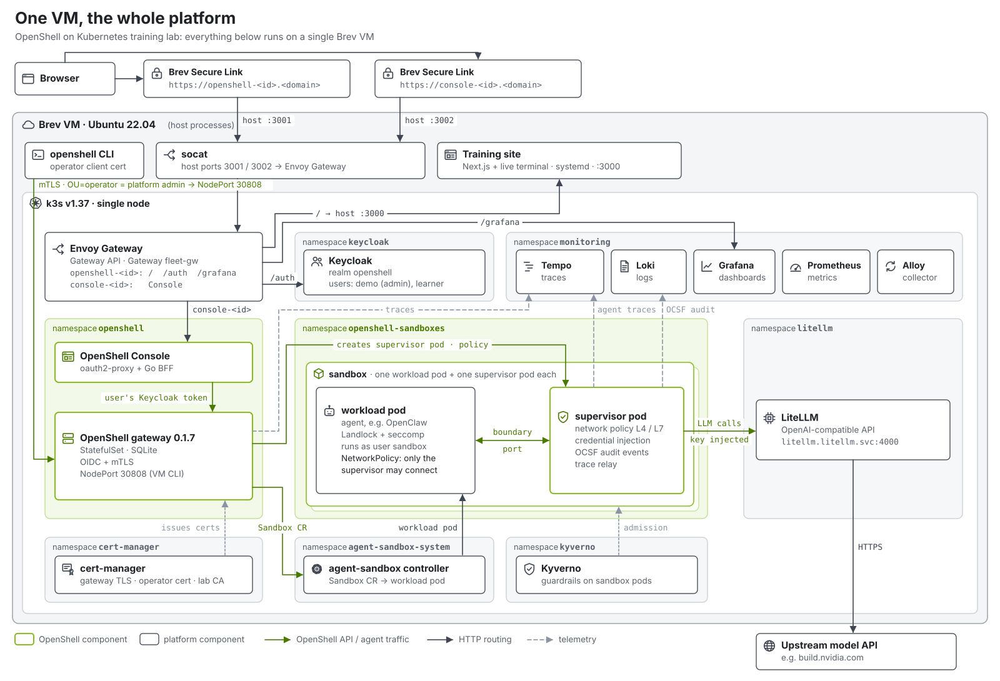
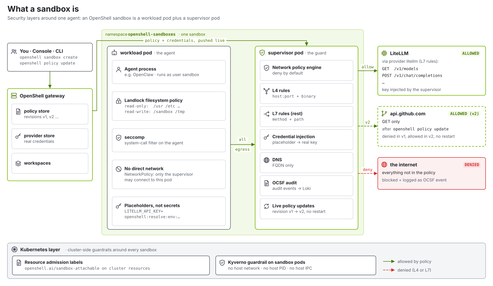
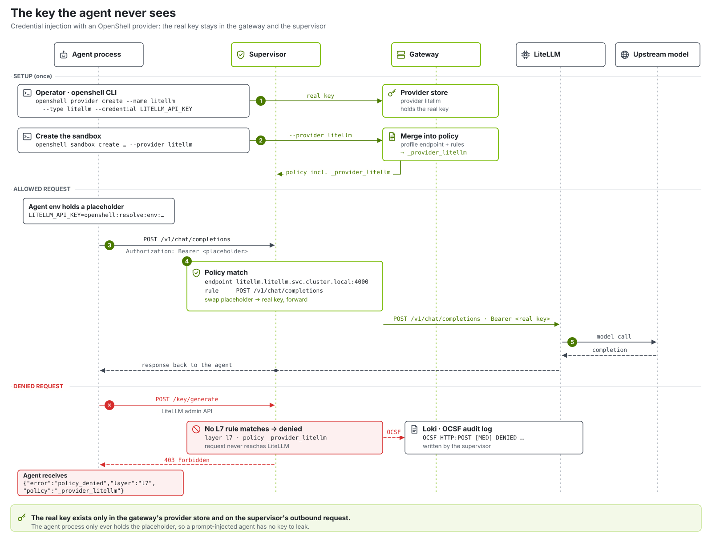

# Architecture & teaching points

A single Brev VM, one `./scripts/setup.sh`, and you have OpenShell 0.1 running agents on
Kubernetes, with people signing in through Keycloak. This doc explains what's underneath and
what's worth pointing at when you teach it.

## The flow

1. **Install**: Ansible runs against this VM: k3s, then the cluster components.
2. **Ask**: you (the CLI, the fleet scripts, the console) call the OpenShell gateway over gRPC.
   People present a Keycloak token; the VM's CLI presents an `OU=operator` client certificate.
3. **Create**: the gateway stores the sandbox and its policy, writes an `agents.x-k8s.io`
   `Sandbox` resource and starts a **supervisor pod**; the agent-sandbox controller turns the
   resource into the **workload pod**.
4. **Seal**: the workload pod runs the agent as user `sandbox` under Landlock and seccomp; a
   NetworkPolicy lets it talk only to its supervisor.
5. **Govern**: every connection and request goes through the supervisor: DNS (FQDN only),
   the network policy (L4 host/port/binary, L7 method/path), provider credentials swapped
   in for placeholders, and an OCSF event per decision.
6. **Think**: the agent calls LiteLLM's own API with `LITELLM_API_KEY` (a placeholder from
   the `litellm` provider); the supervisor injects the real key; LiteLLM calls the model.
7. **Observe**: OCSF events land in Loki (supervisor logs via Alloy, and OTLP from the
   gateway), agent spans in Tempo (the supervisor's trace relay), metrics in Prometheus.

## The components (Ansible roles)

| Role | What it teaches |
|---|---|
| `03-k3s` | A real, single-binary Kubernetes, the substrate everything else lands on. |
| `04-agent_sandbox` | The upstream **agent-sandbox** CRD/controller: sandboxes as first-class Kubernetes objects. |
| `05-litellm` | One OpenAI-compatible endpoint in front of any model; central token metrics. |
| `08b-cert_manager` | Certificates as a service: gateway TLS, the operator certificate, a lab CA. |
| `07-keycloak` | One identity provider for the console, Grafana and the gateway. |
| `09-openshell_gateway` | The **control plane**: a Kubernetes compute driver, policies, providers, identities. |
| `10-cli_providers` | Workspaces in operator mode (the `lab` namespace, labelled and prepared with the `openshell-workspace` chart) and model access as a **provider**: a profile (endpoint + L7 rules + credential contract) and a stored key. |
| `11-kyverno` | Policy-as-code guardrails on the pods OpenShell creates. |
| `12-monitoring` | Prometheus + Grafana + Loki + Alloy + Tempo: metrics, the audit trail, traces. |
| `14-envoy_gateway` / `15-console` | Gateway API ingress and the upstream OpenShell Console. |
| `19-skill-repo` | Gitea with `platform/skills`: Agent Skills in git, cloned read-only by sandboxes. |
| `manifests/tools` | The **sre-tools** MCP server: read-only tools over pods, events, Prometheus, Loki and Tempo, for Modules 3 and 4. |
| `16-sandboxes` | Create the initial sandbox, `agent-0`, through the CLI. |

## The security story

- **Process isolation**: the agent runs unprivileged under Landlock (filesystem) and seccomp.
  OpenShell 0.1 requires Landlock ABI v3 (Linux 6.2+). gVisor cannot host 0.1 sandboxes: it
  implements neither Landlock nor the seccomp notifications the runtime needs.
- **Network isolation**: the workload pod's only peer is its supervisor (NetworkPolicy); the
  supervisor enforces a deny-by-default policy, live-updatable, with L7 rules for REST.
- **Credential isolation**: providers keep credentials in the gateway; sandboxes see
  placeholders; the supervisor substitutes the real value only on requests the provider's
  profile allows. A compromised agent cannot read the key and cannot use it elsewhere.
- **Control-plane identity**: no anonymous gateway calls. Keycloak roles
  (`openshell-admin`, `openshell-user`) and workspace membership decide what people can do.
- **Kubernetes guardrails**: resource admission labels (`openshell.ai/sandbox-attachable`)
  and Kyverno (no host network/PID/IPC on sandbox pods).
- **Audit**: OCSF events for every allow and deny, queryable in Loki and Grafana.

## Sign-in & ingress (`ENABLE_SSO`, default on)

- **Two public hosts.** `https://openshell-<brevid>.<domain>` (host port 3001) serves the
  training site at `/`, Keycloak at `/auth` and Grafana at `/grafana`;
  `https://console-<brevid>.<domain>` (host port 3002) serves the console. A socat forwarder on
  each low port hands traffic to the Envoy ingress, which routes by host name.
- **One issuer, reachable from inside.** The Keycloak issuer is the public URL (that is what
  browsers see and what tokens carry). Inside the cluster CoreDNS rewrites that host name to
  Keycloak's own HTTPS port, whose certificate comes from the lab CA; the gateway and the
  console's oauth2-proxy trust a bundle of the public roots plus the lab CA. No in-cluster
  call goes out through the public edge.
- **The console** ([ai-openshell/console](https://github.com/ai-openshell/console)) is an
  oauth2-proxy in front of a Go BFF. It forwards each user's access token to the gateway, which
  decides; the Keycloak client adds the gateway audience (`openshell-cli`) to the token.

## Running a different agent

pi is the agent because it is in the gateway's default sandbox image, `images/pi-sandbox`
(`sandbox_image_repository` / `sandbox_image_tag` in `ansible/inventory/group_vars/all.yml`).
To run another agent, create sandboxes `--from <image>` (or change the default), attach the
`litellm` provider, and point the agent at `http://litellm.litellm.svc.cluster.local:4000/v1`
with `$LITELLM_API_KEY`, as the pi image's launcher does.

Images must ship a policy that is valid for 0.1 in `/etc/openshell/policy.yaml`, or be created
with `--policy`.

## Single-node vs multi-node

This launchable defaults to **single-node** (`mesh_iface: ""`, localhost inventory). The
same roles drive a multi-node cluster from a workstation over SSH; see
[../ansible/README.md](../ansible/README.md).
